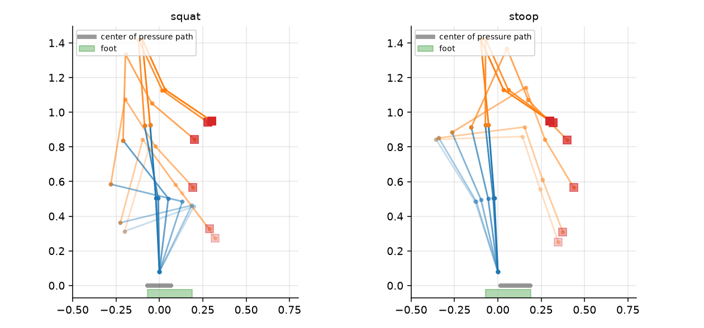
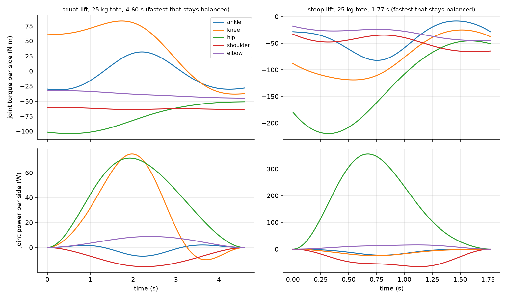
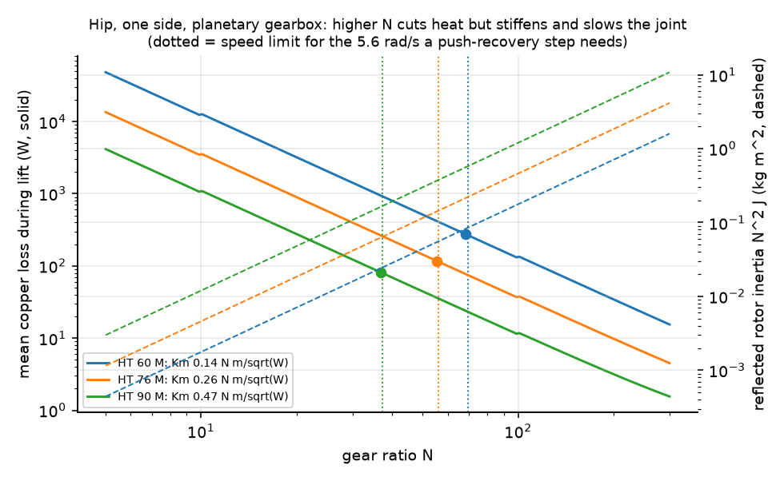
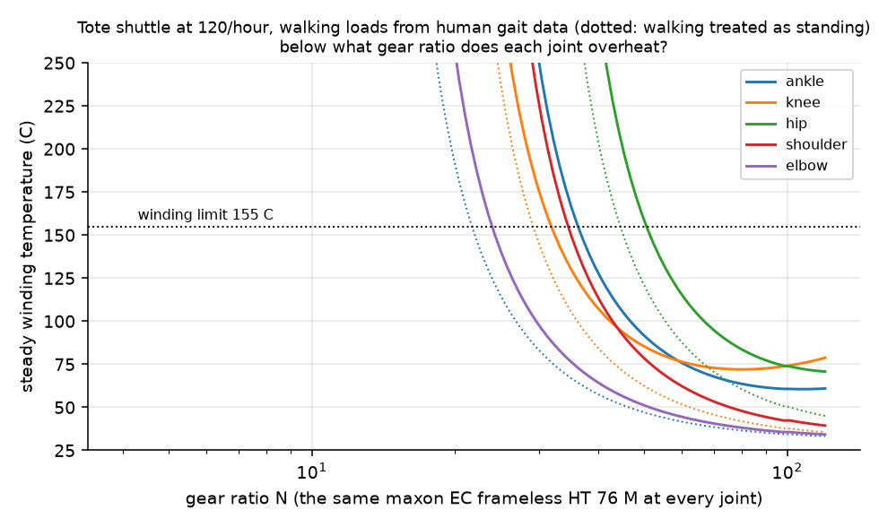
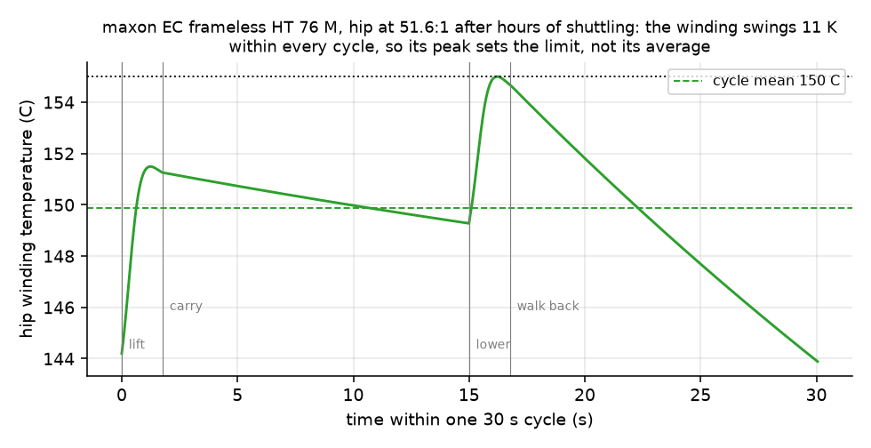
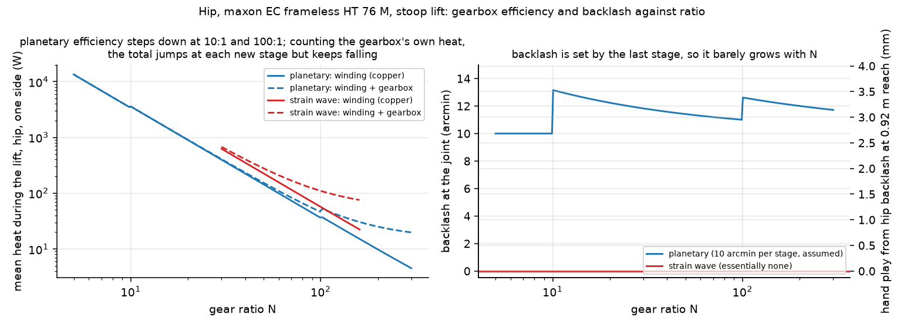
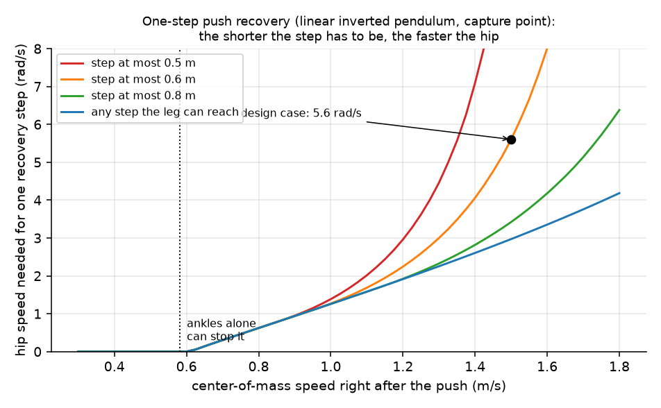
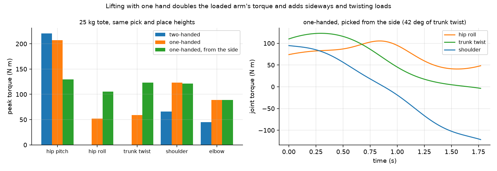
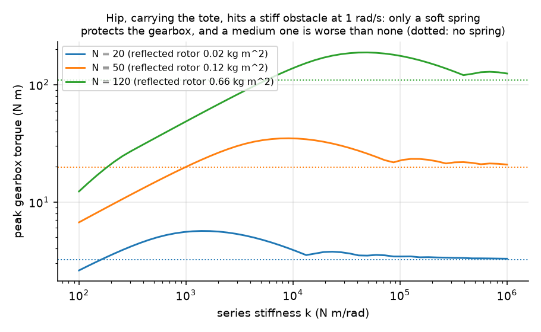

# actuator-sizer

[](https://github.com/aneeshkaravadi/actuator-sizer/actions/workflows/ci.yml)

How big does a humanoid robot's hip motor need to be if its job is moving 25 kg totes all day? This repo works it out from the task backwards: simulate the lift, get the torque every joint needs, then pick motors and gear ratios and see what overheats.



## The model

It's a human-sized robot (1.73 m, 73 kg) in MuJoCo, simplified to a side view with both legs and both arms lumped together, since a two-handed lift is symmetric. Segment lengths, masses, centers of mass and inertias come from human anthropometry tables (Winter), which is roughly where human-scale humanoids end up anyway. The robot plans a pick posture and a finish posture with inverse kinematics, blends between them with a minimum-jerk profile, and MuJoCo's inverse dynamics tells me the torque at each joint at every instant. The feet are bolted down, so I check balance separately by tracking where the center of pressure lands under the foot.

The first sanity check I trusted: over a whole lift, the total work done by all the joints matches the gain in potential energy to within 1%.

## What one lift needs

Per side, for a stoop lift in 1.8 s, the hip is doing almost all the work: 220 N·m peak and about 355 W. Done in the same time, a squat lift needs 44% less hip torque, which is the "lift with your legs" advice working the way you'd expect.



## Balance turned out to be the real limit

This was the surprise. When I tried to speed up the squat lift, the center of pressure ran off the back of the heel, because rising quickly out of a deep squat throws the body backwards. The fastest squat that stays balanced takes 4.5 s, against 1.7 s for the stoop. So for a robot with feet this size, lifting with your legs makes the lift itself take 2.6 times as long. In the tote shuttle below, that stretches each 30 s cycle to 36 s, or 101 totes an hour instead of 120, which matters if the whole point is throughput.

## Picking a gear ratio

I expected to find an optimal gear ratio and got something else. For a slow lift that's mostly fighting gravity, motor heat keeps going down the higher you make the ratio, forever. What actually stops you is everything else a high ratio costs: the joint can't move fast anymore, and the motor's rotor inertia gets multiplied by N², which you feel in every collision. So the plot on the left is a trade space, not an answer, and the dotted lines are where the hip gets too slow to catch the robot after a hard shove (next section).

 

On the right, the same mid-size motor at every joint (maxon's EC frameless HT 76 M, next section) does 120 totes an hour (lift, carry, lower, walk back). The hip overheats first, below about 51:1. The ankle is next at 36:1, because walking loads it far more than standing does (the dotted lines are what I got when I treated walking as standing), and then the shoulder holding the tote out in front at 35:1. That rules out the low ratios that make a robot backdrivable and safe around people (6 to 10:1) for a motor this size.

## Real motors instead of made-up ones

My first version used three motors I'd made up to span a realistic range. Swapping in three real frameless kits from maxon's catalog changed the answer a lot. These are the EC frameless HT 60 M, 76 M and 90 M, with every number from their product pages and maxon's catalog. The real kits are lighter (226 to 649 g) and have lower motor constants (0.14 to 0.47 N·m/√W, against 0.22 to 1.24 for mine), so they make more heat for the same torque. My made-up mid-size motor had said 12:1 was enough at the hip for the shuttle. The real one needs about 45:1 with walking still treated as standing, and 51:1 once walking is in (next section).

With real motors the shuttle sets a minimum ratio at the hip, from heat, and the push recovery (below) sets a maximum, from speed. A motor only works if there's room between the two. The 226 g kit has none: it needs 112:1 to stay cool, but past 69:1 it's too slow, and once walking is in it can't do the knee at any ratio up to 300:1. The 376 g kit works from 51 to 56:1, and the 649 g kit from 24 to 37:1. Each minimum also has to pass the motor's peak torque and speed limits, not just heat. These are with each kit mounted the way maxon rates it, and the next section shows why that matters.

Two details came out of the datasheets. maxon gives two thermal resistances and two time constants instead of one, so the winding temperature model has two nodes: the winding heats up in under a minute and a half, the housing over several minutes. And maxon's general rule is that the stall torque equals the torque constant times the stall current, but for these kits it lists only about a quarter of that, and it says its frameless motors' curves aren't strictly linear. My reading is that the iron saturates, so I cap the current at the listed stall torque. maxon doesn't publish the curve, so that part is my inference.

The tests cross-check the datasheet numbers against each other (torque constant against speed constant, stall current against V/R, the speed/torque gradient and mechanical time constant against the resistance and rotor inertia, the maximum efficiency against the no-load current), which would catch a typo. The thermal numbers get a check of their own. maxon defines the nominal current as the continuous current that takes the winding to 155 °C at 25 °C ambient. Fed that current at the nominal speed, my first model only got the three windings to 99 to 108 °C, because it counted copper loss and nothing else. maxon treats a brushless motor's iron losses as a friction torque equal to the torque constant times the no-load current. With those in, the three kits land at 153 to 164 °C.

I also checked whether averaging the heat over each cycle was hiding anything. Run through hours of real 30 s cycles, the hip's winding swings 11 K within each one. The hottest moment isn't the lift but the lowering, because the loaded carry keeps the winding warm right before it. The peak sits about 5 K above the cycle's average, which nudges the hip's limit from 50.5 to 51.6:1. So the averaged analysis is close here, since the winding's own time constant (54 s) is longer than the cycle, but it isn't conservative.



## How sure is that 51:1?

The shuttle number rests on things I had to assume, so I checked how far each one moves it, for the 376 g kit at the hip.

**Walking.** My first shuttle treated the carry and the walk back as standing still, so walking back empty added almost nothing (4 J of the hip's 678 J per cycle). To get real walking loads I took one mean stride from a public gait dataset (Fukuchi, Fukuchi and Duarte, PeerJ 2018: 42 adults walking at their comfortable speed, 1.27 m/s on average). I scaled its hip, knee and ankle moments to the mass the robot's legs carry (98 kg with the tote) and added their swing over each stride on top of the standing torques. That's human walking, not robot walking, but it's measured instead of guessed. It takes the hip from about 45 to 51:1 and the ankle from 22 to 36:1. People differ: scaled to the people in the dataset with the smallest and largest swings in joint moment over a stride, the hip needs 48 to 55:1.

**Mounting.** maxon's catalog gives a range for each kit's housing-to-air thermal resistance. The product-page value, which the ratings use, is for the kit built into an aluminium housing that's bolted to a big aluminium plate. The same housing without the plate is about twice as bad (2.9 K/W instead of 1.5 for the 376 g kit). A robot joint sits somewhere in between, depending on how much metal it's bolted to. Without the plate, the 376 g kit needs 64:1 at the hip, past its 56:1 speed limit, so it has no window left. The 649 g kit's window shrinks to 31 to 37:1.

**Torque constant.** At 51:1 the hip motor peaks at 3.7 times its rated torque, two thirds of the way to the listed stall torque, which is where a saturating motor makes less torque per amp. maxon doesn't publish that curve, so I tried torque per amp falling steadily from twice the rated torque to 20% or 40% less at stall. That moves the hip to 52 or 54:1.

So the 376 g kit is marginal. It fits on maxon's test plate, but everything I'm unsure about pushes the hip toward its speed limit, and with a poor heat path it doesn't fit at all. The 649 g kit still has room with or without the plate.

## What the gearbox costs

I first used a constant 90% gearbox efficiency. A real planetary gearbox adds a stage for every 10:1 or so, and each stage costs a few percent, so I made efficiency step down with the number of stages (0.97 per stage, an assumption) and counted the gearbox's own friction heat too. The winding heat keeps falling with ratio, but the gearbox's share keeps growing, and past about 160:1 the gearbox makes most of the heat. Each extra stage also costs a step: the total goes from 46.0 W at 100:1 to 52.8 W just past it, once a third stage is needed.

Lowering a tote runs the gearbox backwards, with the load driving the motor, and then friction helps hold the load instead of fighting the motor. For friction-type losses the backwards efficiency is $2 - 1/\eta$, so the motor needs less torque going down than coming up. The shuttle numbers above include that.

A strain-wave gearbox gets a high ratio in one stage with essentially no backlash, but at an assumed 75% efficiency it makes 1.8 times the heat of a two-stage planetary at 50:1 (279 W against 153 W), and five times the gearbox heat. Backlash barely depends on the ratio, because each stage's play reaches the output divided by the ratio of the stages after it, so the last stage sets it. At 50:1 that's about 11 arcmin, which lets the hands wander about 3 mm at the hip's 0.92 m reach.



## How fast does the hip need to be?

The gear-ratio trade needs a top speed for the hip, and at first I just assumed 6 rad/s. To get it from an actual task instead, I looked at about the fastest thing a hip has to do, which is catching the robot with one step after a shove. I treated the robot as an inverted pendulum, with its center of mass at 1.05 m, taken from the MuJoCo model. A push that leaves the center of mass moving slower than 0.58 m/s can be stopped by the ankles alone. Anything harder needs a step, and the foot has to land where the robot's capture point has got to by then, which runs away exponentially. A slow step needs a long stride, and a short stride needs a fast step.

So the hip speed you need depends as much on how far the robot is allowed to step as on the push. With unlimited stride, a 1.5 m/s shove needs only 3.0 rad/s at the hip. With the step capped at 0.6 m it needs 5.6 rad/s, landing 0.15 s after the push. At 0.5 m it would take a swing quicker than the 80 ms I allow (12.4 rad/s in 68 ms). I used the 5.6 rad/s case for the dotted lines above. It came out close to my guess, but now it comes from a push and a stride length you can argue about. It also assumes the robot reacts instantly, so a real one needs more.



## One hand, and a twist

Everything above is a symmetric two-handed lift. To see what changes with one hand, I added hip roll and trunk twist joints and gave the tote to one arm, at the shoulder's sideways offset. The legs are still lumped together. Picking the same 25 kg tote with one hand roughly doubles what the loaded arm needs: 123 N·m at the shoulder instead of 66, and 89 at the elbow instead of 45.

It also adds loads the two-handed model doesn't have at all. Stooped over, the trunk's long axis is nearly horizontal, so a weight off to one side twists the spine (59 N·m) even in a straight-ahead pick, and the hips have to keep it from tipping sideways (52 N·m, both hips together). Picking the tote from out to the side, with 42° of twist, about doubles both of those, to 123 N·m of twist and 105 N·m of hip roll. The twist alone is then about as much as each hip's pitch actuator needs in that lift (129 N·m), so a robot that sometimes lifts one-handed needs a real waist actuator, not just a passive joint.



## Do series springs help?

I modeled the hip, carrying the tote, running into something stiff at 1 rad/s, with a spring between the gearbox and the leg. The leg side's inertia comes from the model's own mass matrix (6.6 kg m² per side in that posture). The spring helps less than I expected. At a 120:1 ratio a 3000 N·m/rad spring cuts the shock on the gearbox from 110 to 82 N·m, but at 50:1 it makes it worse (30 against 20 N·m), because there's not much rotor inertia to protect against in the first place. A medium-stiff spring is worse than none at every ratio, up to 189 N·m at 120:1. To help, the spring has to be softer than roughly 6000 N·m/rad at 120:1 and 1000 N·m/rad at 50:1, and at 3000 N·m/rad it already deflects 0.073 rad at peak hip torque.



There's also a quick air-core vs iron-core motor comparison ([figure](docs/figures/aircore_vs_iron.png)) and a CAD envelope for the hip actuator: motor bay, gearbox bay and output flange ([STEP](cad/hip_actuator_envelope.step)).

<!-- TODO(Aneesh): replace or add next to the generated envelope with your own SolidWorks model, e.g.

and put the native file in cad/solidworks/
-->

## Things I got wrong first

- My first inverse dynamics run said the hip needed about 40,000 N·m. The body and the tote were sinking into the floor in the stoop posture and MuJoCo was adding contact forces. Turning contacts off (the feet are fixed anyway) fixed it.
- My "squat" inverse kinematics kept quietly turning into a stoop, because it started from a standing pose and found the nearest answer. Seeding it from a squat posture fixed that.
- Both lifts originally put the center of pressure past the toes, until I made balance a much stronger term in the posture solver and moved the tote closer to the body.
- My first thermal study used a 120:1 ratio everywhere and nothing came close to overheating, which told me nothing. Sweeping the ratio is what made it useful.
- My balance check took the floor's force as just the weight and left out the ankle's height above the floor. In a fast stoop the floor force swings between 0.89 and 1.12 times the weight, and the forward push on the foot acts 8 cm below the ankle. I found it when I checked the center of pressure against the zero-moment point worked out from each body's motion, and they disagreed by up to 20 mm. Fixed, the fastest balanced stoop went from 1.55 to 1.72 s and the squat from 4.2 to 4.5 s, and the 1.52 s stoop my motor numbers used to come from had been tipping onto the toes.
- I built the legs from the ankle up but measured their centers of mass from the ankle and knee, when Winter's table measures them from the knee and hip, so both sat too low. I also had the trunk's center of mass at 60% of the way to the shoulder instead of the table's 66%, and rough rod inertias instead of the table's radii of gyration. I found these going back through the table line by line.
- The shuttle treated the carry and the walk back as standing still, so walking back added almost nothing to the hip's heat. With walking loads from real gait data the hip needs 51:1 instead of about 45.
- I only counted copper loss in the motors. maxon's own rating says that isn't enough: at the rated current my model came out 47 to 56 K cooler than maxon's limit. Counting iron losses brings it to within 10 K.
- My minimum ratios were the first passing point on a coarse grid, so they were up to 6% high, and my ripple check compared one of those with an exact value. Every limit now comes from bisection, and it has to pass the motor's torque and speed limits too.
- For the spring study I guessed the hip's link inertia at 1.5 kg m². The model's own mass matrix says 3.9 to 18 kg m² per side, depending on posture and the tote. With the real number, a 3000 N·m/rad spring at 120:1 only cuts the gearbox shock from 110 to 82 N·m instead of 218 to 74, and at 50:1 it makes things worse.
- I wrote that lifting with your legs costs 2.6 times the cycle time. It's 2.6 times the lift time, and the whole shuttle cycle gets about 19% longer.

## Running it

```bash
pip install -e ".[dev,cad]"
pytest -q
python examples/make_figures.py
```

The motors are three maxon frameless kits, with every number from maxon's product pages except the no-plate thermal resistance, which is from maxon's 2026/27 catalog, and the made-up ones I started with are still in the code as `ILLUSTRATIVE_MOTORS`. The walking loads are a small extract of Fukuchi, Fukuchi and Duarte's public gait dataset (CC BY 4.0), credited in [src/actsizer/data](src/actsizer/data/wbds_comfortable_walking.csv). The physics is written out in [DERIVATIONS.md](DERIVATIONS.md). Open questions and next steps are in [issues](https://github.com/aneeshkaravadi/actuator-sizer/issues).

---

Aneesh Karavadi, dual-enrolled engineering student at UNT through TAMS. I do most of my CAD in SolidWorks, Fusion and Onshape. I used Claude Code to write a lot of the implementation, but I picked the problems and the checks, and the conclusions are mine.
